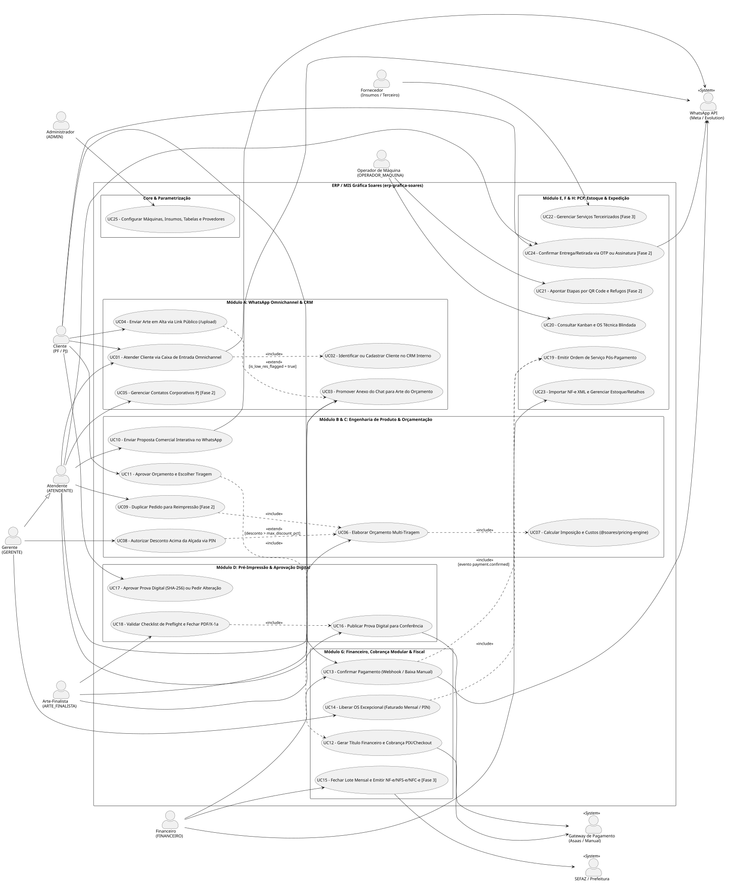

# UseCase

# Especificação de Casos de Uso — ERP / MIS Gráfica Soares

**Projeto:** `erp-grafica-soares` (`@soares/*`)

**Escopo:** Modelagem funcional dos atores internos (RBAC), clientes sem login no MVP, fornecedores e integrações externas (WhatsApp API, Gateways de Pagamento e SEFAZ/Prefeitura).

---

## 1. Diagrama de Casos de Uso

---

## 2. Tabelas de Especificação de Casos de Uso

### Pacote 1 — Módulo A: WhatsApp Omnichannel & CRM

#### `UC01` — Atender Cliente via Caixa de Entrada Omnichannel

| Campo | Especificação |
| --- | --- |
| **Identificador / Nome** | `UC01` — Atender Cliente via Caixa de Entrada Omnichannel |
| **Módulo / Fase** | Módulo A — WhatsApp & Atendimento Omnichannel `[MVP]` |
| **Atores** | Atendente (Primário), Cliente, WhatsApp API (Secundários) |
| **Pré-condições** | Provedor de mensageria (`IWhatsappProvider` — Meta Cloud API ou Evolution API) configurado e ativo; atendente autenticado no ERP. |
| **Pós-condições** | Mensagens registradas de forma idempotente em `wa_messages`, conversa atualizada em `wa_conversations` e sincronizada em tempo real via `Socket.IO`. |
| **Fluxo Principal** | 1. O Cliente envia mensagem de texto, áudio ou anexo para o número comercial da Gráfica Soares. 2. O webhook enfileira o evento no `BullMQ`/`Redis` garantindo idempotência pelo `wamid`. 3. O sistema executa `«include» UC02` para localizar ou vincular o cliente pelo telefone E.164. 4. O sistema atualiza `window_expires_at` (+24h) e notifica o painel via `Socket.IO`. 5. O Atendente assume o ticket (`assigned_user_id`, status `EM_ATENDIMENTO`) e responde ao Cliente. |
| **Fluxos Alternativos / Exceções** | **FA01 — Janela de 24h expirada (`RN09`):** Se `window_expires_at < now()`, o sistema bloqueia texto livre e exige o disparo via `wa_notification_templates` pré-aprovado na Meta. **EX01 — Falha de entrega:** O webhook atualiza `delivery_status = 'FAILED'` e exibe `error_reason` na interface. |
| **Requisitos / Regras** | `RF01`, `RF02`, `RN09`, `RNF01`, `RNF04` |
| **Tabelas Envolvidas** | `wa_conversations`, `wa_messages`, `wa_notification_templates` |

#### `UC02` — Identificar ou Cadastrar Cliente no CRM Interno

| Campo | Especificação |
| --- | --- |
| **Identificador / Nome** | `UC02` — Identificar ou Cadastrar Cliente no CRM Interno |
| **Módulo / Fase** | Módulo A / Módulo C — CRM Interno `[MVP]` |
| **Atores** | Atendente (Primário), Cliente (Secundário) |
| **Pré-condições** | Conversa ativa recebida em `wa_conversations` com número normalizado no formato E.164. |
| **Pós-condições** | Registro do cliente criado ou localizado em `customers` e vinculado a `wa_conversations.customer_id` sem criação de login/senha (`RN02`). |
| **Fluxo Principal** | 1. O sistema busca o número E.164 em `customers.whatsapp_phone` e `customer_phones.phone_e164`. 2. Caso encontre, vincula automaticamente `customer_id` à conversa. 3. Caso não encontre, o sistema verifica se o Cliente enviou CPF (11 dígitos) ou CNPJ (14 dígitos) na mensagem. 4. Se localizado pelo documento, adiciona o novo telefone em `customer_phones`. 5. Caso seja cliente novo, o Atendente preenche o cadastro fiscal rápido (`person_type`, `name`, `document_cpf_cnpj`, `price_table_id`, `billing_type`) na barra lateral do chat. |
| **Fluxos Alternativos / Exceções** | **EX01 — Documento duplicado:** Se o CPF/CNPJ já existir em `customers`, o sistema impede duplicidade e sugere vincular o novo telefone ao cadastro existente. |
| **Requisitos / Regras** | `RF02`, `RN02` |
| **Tabelas Envolvidas** | `customers`, `customer_phones`, `customer_addresses`, `price_tables` |

#### `UC03` — Promover Anexo do Chat para Arte do Orçamento

| Campo | Especificação |
| --- | --- |
| **Identificador / Nome** | `UC03` — Promover Anexo do Chat para Arte do Orçamento |
| **Módulo / Fase** | Módulo A / Módulo D — WhatsApp & Pré-Impressão `[MVP]` |
| **Atores** | Atendente, Arte-Finalista (Primários) |
| **Pré-condições** | Mídia recebida na conversa (`wa_media_attachments`) e orçamento (`quotes`) existente em rascunho ou negociação. |
| **Pós-condições** | Arquivo registrado em `artwork_files` (`file_stage = 'CLIENTE_ORIGINAL'`, `source = 'WHATSAPP'`) associado ao `quote_id` antes mesmo da emissão da OS. |
| **Fluxo Principal** | 1. Ao receber imagem/documento no chat, o worker salva uma cópia no Cloudflare R2 e inspeciona a resolução via `Sharp` (`resolution_dpi`). 2. O Atendente ou Arte-Finalista seleciona o anexo na conversa e escolhe o orçamento de destino (`quote_id`). 3. O sistema cria o registro em `artwork_files` com `sha256_hash` e preenche `wa_media_attachments.linked_artwork_file_id`. |
| **Fluxos Alternativos / Exceções** | **FA01 — Baixa resolução detectada:** Se `is_low_res_flagged = true`, o sistema exibe alerta visual e habilita a extensão `«extend» UC04`. |
| **Requisitos / Regras** | `RF03`, `RF04`, `RF19`, `RNF02` |
| **Tabelas Envolvidas** | `wa_media_attachments`, `artwork_files`, `quotes` |

#### `UC04` — Enviar Arte em Alta via Link Público (`/upload`)

| Campo | Especificação |
| --- | --- |
| **Identificador / Nome** | `UC04` — Enviar Arte em Alta via Link Público (`/upload`) |
| **Módulo / Fase** | Módulo A / Módulo D — WhatsApp & Pré-Impressão `[MVP]` |
| **Atores** | Cliente (Primário), Atendente (Secundário) |
| **Pré-condições** | Orçamento ativo e link temporário `/upload/[token]` gerado para evitar compressão do WhatsApp (`is_low_res_flagged = true` ou arquivo pesado). |
| **Pós-condições** | Arquivo original (PDF/X-1a, CDR, AI, TIFF) armazenado no Cloudflare R2 sem compressão e registrado em `artwork_files` (`source = 'UPLOAD_LINK'`). |
| **Fluxo Principal** | 1. O Atendente gera e envia a URL `/upload/[token]` vinculada ao orçamento na conversa do WhatsApp. 2. O Cliente abre o link no navegador sem necessidade de login. 3. O Cliente seleciona os arquivos pesados; o navegador realiza upload direto ao Cloudflare R2 via *Presigned URL*. 4. O backend calcula o `sha256_hash` e grava o arquivo em `artwork_files` vinculado ao `quote_id`. |
| **Fluxos Alternativos / Exceções** | **EX01 — Token expirado ou inválido:** O sistema bloqueia o envio e orienta o cliente a solicitar um novo link ao atendente. |
| **Requisitos / Regras** | `RF04`, `RF19`, `RN02`, `RNF02` |
| **Tabelas Envolvidas** | `artwork_files`, `quotes` |

#### `UC05` — Gerenciar Contatos Corporativos PJ

| Campo | Especificação |
| --- | --- |
| **Identificador / Nome** | `UC05` — Gerenciar Contatos Corporativos PJ |
| **Módulo / Fase** | Módulo C — CRM Interno `[Fase 2]` |
| **Atores** | Atendente (Primário) |
| **Pré-condições** | Cliente cadastrado com `person_type = 'PJ'` em `customers`. |
| **Pós-condições** | Contatos setoriais gravados em `customer_contacts` com permissões específicas de aprovação. |
| **Fluxo Principal** | 1. O Atendente acessa a ficha do cliente PJ. 2. Cadastra os colaboradores da empresa cliente informando `name`, `role` (ex.: Designer, Comprador, Financeiro), `whatsapp_phone` e `email`. 3. Define as flags `can_approve_art` e `can_approve_quote` para direcionar provas digitais e propostas comerciais ao responsável correto. |
| **Fluxos Alternativos / Exceções** | **EX01 — Cliente Pessoa Física:** O sistema oculta o gerenciamento de múltiplos contatos corporativos quando `person_type = 'PF'`. |
| **Requisitos / Regras** | `RF17` |
| **Tabelas Envolvidas** | `customers`, `customer_contacts` |

---

### Pacote 2 — Módulo B & C: Engenharia de Produto & Orçamentação

#### `UC06` — Elaborar Orçamento Multi-Tiragem

| Campo | Especificação |
| --- | --- |
| **Identificador / Nome** | `UC06` — Elaborar Orçamento Multi-Tiragem |
| **Módulo / Fase** | Módulo B & C — Orçamentação & CRM `[MVP]` |
| **Atores** | Atendente (Primário), Gerente (Secundário) |
| **Pré-condições** | Cliente identificado em `customers` (com `price_table_id` associado); máquinas, materiais e acabamentos ativos no catálogo. |
| **Pós-condições** | Orçamento salvo em `quotes` (`status = 'RASCUNHO'`), com itens em `quote_items`, até 4 simulações por item em `quote_item_tiers` e acabamentos em `quote_item_finishings`. |
| **Fluxo Principal** | 1. O Atendente inicia um orçamento vinculado ao cliente e à conversa (`conversation_id`). 2. Adiciona um ou mais itens selecionando um `product_template` ou informando dimensões (`width_mm`, `height_mm`, `bleed_mm`) e cores (`colors_front`, `colors_back`). 3. Seleciona os acabamentos em `finishing_services` e informa até 4 faixas de quantidade (ex.: 100, 500, 1.000, 2.500). 4. Para cada faixa, o sistema executa `«include» UC07` e armazena o snapshot completo de custos e preços em `quote_item_tiers`. 5. O Atendente define a validade (`valid_until`) e salva a proposta. |
| **Fluxos Alternativos / Exceções** | **FA01 — Desconto acima da alçada (`RN06`):** Se o desconto aplicado exceder `users.max_discount_pct`, o sistema aciona `«extend» UC08` antes de permitir salvar/enviar. |
| **Requisitos / Regras** | `RF11`, `RF12`, `RF13`, `RF15`, `RF18`, `RN05`, `RN06` |
| **Tabelas Envolvidas** | `quotes`, `quote_items`, `quote_item_tiers`, `quote_item_finishings`, `price_tables` |

#### `UC07` — Calcular Imposição e Custos (`@soares/pricing-engine`)

| Campo | Especificação |
| --- | --- |
| **Identificador / Nome** | `UC07` — Calcular Imposição e Custos (`@soares/pricing-engine`) |
| **Módulo / Fase** | Módulo B — Motor de Orçamentação & Engenharia `[MVP]` |
| **Atores** | Atendente (Acionador via `UC06`) |
| **Pré-condições** | Dimensões da peça, substrato (`materials`), equipamento (`machines`), acabamentos e tabela de preço (`price_tables`) informados. |
| **Pós-condições** | Aproveitamento geométrico, consumo de matéria-prima, quebra de setup e formação de preço calculados em menos de 300ms (`RNF03`). |
| **Fluxo Principal** | 1. O motor calcula quantas peças cabem na folha/bobina nas orientações `RETRATO` e `PAISAGEM`, descontando `gripper_margin_mm`, `bleed_mm` e `spacing_mm`. 2. Seleciona a orientação com maior `pieces_per_sheet` e calcula `net_sheets_needed` (ou m²). 3. Soma automaticamente `machines.setup_waste_sheets` (`RN04`) para compor o consumo total de substrato. 4. Calcula o custo de máquina conforme `billing_unit` (`CLIQUE`, `HORA` ou `M2`) + `setup_cost`, além dos acabamentos (`POR_UNIDADE`, `POR_FOLHA`, `POR_M2`, `FIXO_SETUP`). 5. Aplica impostos, comissão (`users.commission_pct`) e `price_tables.markup_multiplier` para obter `unit_price` e `total_price`. |
| **Fluxos Alternativos / Exceções** | **FA01 — Prioridade de retalhos `[Fase 3]` (`RN08`):** Para bobinas/chapas rígidas, o motor consulta `material_remnants` (`status = 'DISPONIVEL'`) antes de sugerir substrato inteiro. **EX01 — Dimensão excede área útil:** Se a peça ultrapassar `max_width_mm` ou `max_height_mm` da máquina, o motor retorna erro de validação técnica. |
| **Requisitos / Regras** | `RF09`, `RF10`, `RF11`, `RF13`, `RF28`, `RN04`, `RN08`, `RNF03` |
| **Tabelas Envolvidas** | `machines`, `materials`, `finishing_services`, `product_templates`, `material_remnants` |

#### `UC08` — Autorizar Desconto Acima da Alçada via PIN

| Campo | Especificação |
| --- | --- |
| **Identificador / Nome** | `UC08` — Autorizar Desconto Acima da Alçada via PIN |
| **Módulo / Fase** | Módulo C / Core — Alçada & Auditoria `[MVP]` |
| **Atores** | Gerente (Primário), Atendente (Secundário) |
| **Pré-condições** | Orçamento com desconto percentual superior a `users.max_discount_pct` do atendente; gerente ativo com `approval_pin_hash` cadastrado. |
| **Pós-condições** | Desconto autorizado, `quotes.discount_authorized_by` preenchido e evento registrado em `audit_logs` (`OVERRIDE_DISCOUNT`). |
| **Fluxo Principal** | 1. O ERP bloqueia a finalização do orçamento quando o desconto supera `max_discount_pct`. 2. O Gerente informa suas credenciais/PIN numérico (4–6 dígitos) no modal de autorização. 3. O sistema valida o hash contra `users.approval_pin_hash`. 4. O sistema grava o UUID do gerente em `quotes.discount_authorized_by` e insere registro imutável em `audit_logs`. |
| **Fluxos Alternativos / Exceções** | **EX01 — PIN inválido ou perfil sem permissão:** O sistema rejeita a operação e mantém o bloqueio do orçamento. |
| **Requisitos / Regras** | `RN06`, `RNF05` |
| **Tabelas Envolvidas** | `users`, `quotes`, `audit_logs` |

#### `UC09` — Duplicar Pedido para Reimpressão

| Campo | Especificação |
| --- | --- |
| **Identificador / Nome** | `UC09` — Duplicar Pedido para Reimpressão |
| **Módulo / Fase** | Módulo B — Orçamentação `[Fase 2]` |
| **Atores** | Atendente (Primário) |
| **Pré-condições** | Orçamento ou Ordem de Serviço anterior existente no histórico do cliente. |
| **Pós-condições** | Novo orçamento criado em `RASCUNHO` com especificações técnicas e arquivos clonados, porém com custos e preços recalculados. |
| **Fluxo Principal** | 1. O Atendente localiza um pedido anterior do cliente e aciona "Duplicar Pedido". 2. O sistema clona `quote_items`, `quote_item_finishings` e referencia os `artwork_files` aprovados anteriormente. 3. O sistema executa `«include» UC07` aplicando os custos atuais de `materials` e `machines`. 4. O novo orçamento é aberto em `RASCUNHO` com nova data `valid_until`. |
| **Fluxos Alternativos / Exceções** | **EX01 — Insumo ou máquina inativos (`active = false`):** O sistema alerta o atendente para selecionar um substrato/equipamento substituto antes de recalcular. |
| **Requisitos / Regras** | `RF14` |
| **Tabelas Envolvidas** | `quotes`, `quote_items`, `quote_item_tiers`, `artwork_files` |

#### `UC10` — Enviar Proposta Comercial Interativa no WhatsApp

| Campo | Especificação |
| --- | --- |
| **Identificador / Nome** | `UC10` — Enviar Proposta Comercial Interativa no WhatsApp |
| **Módulo / Fase** | Módulo A / Módulo C — Vendas & WhatsApp `[MVP]` |
| **Atores** | Atendente (Primário), Cliente, WhatsApp API (Secundários) |
| **Pré-condições** | Orçamento em `RASCUNHO` ou `NEGOCIACAO` com pelo menos 1 item e 1 tiragem calculada; desconto dentro da alçada ou autorizado via PIN. |
| **Pós-condições** | PDF da proposta gerado, mensagem interativa enviada no WhatsApp (`QUOTE_SENT`) e `quotes.status` atualizado para `'ENVIADO'`. |
| **Fluxo Principal** | 1. O Atendente clica em "Enviar Proposta no WhatsApp". 2. O worker gera o PDF comercial com a identidade da Gráfica Soares e o comparativo das tiragens simuladas. 3. O sistema envia no WhatsApp do cliente o resumo, o anexo PDF e os botões interativos `[Aprovar Orçamento]` correspondentes às tiragens. 4. O status do orçamento muda para `'ENVIADO'`. |
| **Fluxos Alternativos / Exceções** | **FA01 — Janela de 24h expirada (`RN09`):** O disparo utiliza o template oficial mapeado em `wa_notification_templates` para o evento `QUOTE_SENT`. |
| **Requisitos / Regras** | `RF05`, `RF07`, `RF15`, `RN09` |
| **Tabelas Envolvidas** | `quotes`, `wa_messages`, `wa_notification_templates` |

#### `UC11` — Aprovar Orçamento e Escolher Tiragem

| Campo | Especificação |
| --- | --- |
| **Identificador / Nome** | `UC11` — Aprovar Orçamento e Escolher Tiragem |
| **Módulo / Fase** | Módulo A / Módulo C — Vendas & Fluxo Desacoplado `[MVP]` |
| **Atores** | Cliente (Primário) |
| **Pré-condições** | Orçamento com status `'ENVIADO'` ou `'NEGOCIACAO'` e data atual menor ou igual a `quotes.valid_until` (`RN05`). |
| **Pós-condições** | Tiragem marcada com `is_chosen = true`, `quotes.status = 'AGUARDANDO_PAGAMENTO'`, `quotes.approved_at` gravado e cobrança iniciada (`«include» UC12`) **sem criar OS ainda** (`RN01`). |
| **Fluxo Principal** | 1. O Cliente clica no botão `[Aprovar Orçamento]` no WhatsApp selecionando a tiragem desejada (`tierUuid`). 2. O webhook identifica o `interactive_payload` e verifica se `hoje <= valid_until`. 3. O sistema marca `quote_item_tiers.is_chosen = true`, atualiza `quotes.total_amount`, grava `approved_at` e altera o status para `'AGUARDANDO_PAGAMENTO'`. 4. O sistema executa imediatamente `«include» UC12` para gerar o título financeiro e a cobrança. |
| **Fluxos Alternativos / Exceções** | **EX01 — Proposta expirada (`RN05`):** Se `hoje > valid_until`, o sistema muda o status para `'EXPIRADO'`, bloqueia a aprovação e notifica o atendente para recalcular com custos vigentes. **FA01 — Cliente declina proposta:** O atendente registra status `'PERDIDO'` informando obrigatoriamente `loss_reason` (`RF15`). |
| **Requisitos / Regras** | `RF05`, `RF15`, `RF16`, `RN01`, `RN05` |
| **Tabelas Envolvidas** | `quotes`, `quote_item_tiers`, `wa_messages` |

---

### Pacote 3 — Módulo G: Financeiro, Cobrança Modular & Fiscal

#### `UC12` — Gerar Título Financeiro e Cobrança PIX/Checkout

| Campo | Especificação |
| --- | --- |
| **Identificador / Nome** | `UC12` — Gerar Título Financeiro e Cobrança PIX/Checkout |
| **Módulo / Fase** | Módulo G — Financeiro & Cobrança Modular `[MVP]` |
| **Atores** | Gateway de Pagamento (Secundário — acionado automaticamente por `UC11`) |
| **Pré-condições** | Orçamento aprovado (`AGUARDANDO_PAGAMENTO`) e provedor padrão ativo em `payment_providers` (`is_default = true`). |
| **Pós-condições** | Título `'RECEBER'` criado em `financial_titles` (ligado ao `quote_id`), transação criada em `payment_transactions` e cobrança enviada no WhatsApp. |
| **Fluxo Principal** | 1. O módulo financeiro cria um registro em `financial_titles` (`title_type = 'RECEBER'`, `quote_id`, `service_order_id = NULL`, `status = 'ABERTO'`). 2. Para clientes `AVISTA`, o sistema aciona o adapter ativo (`IPaymentGateway`, ex.: `AsaasAdapter` ou `ManualPixAdapter`). 3. Grava `payment_transactions` (`status = 'PENDING'`, `payment_payload` com PIX Copia e Cola/QR Code ou `checkout_url`). 4. Dispara mensagem automática (`QUOTE_APPROVED` / `PAYMENT_REQUEST`) no WhatsApp com os dados de pagamento e marca `sent_via_wa = true`. |
| **Fluxos Alternativos / Exceções** | **FA01 — Cliente `FATURADO_MENSAL`:** O título permanece em carteira para fechamento mensal (`billing_batches`) e o fluxo segue para `UC14`. |
| **Requisitos / Regras** | `RF07`, `RF08`, `RF16`, `RF33`, `RN01` |
| **Tabelas Envolvidas** | `financial_titles`, `payment_providers`, `payment_transactions` |

#### `UC13` — Confirmar Pagamento (Webhook / Baixa Manual)

| Campo | Especificação |
| --- | --- |
| **Identificador / Nome** | `UC13` — Confirmar Pagamento (Webhook / Baixa Manual) |
| **Módulo / Fase** | Módulo G — Financeiro & Conciliação `[MVP]` |
| **Atores** | Cliente, Financeiro, Gateway de Pagamento |
| **Pré-condições** | Título em `financial_titles` com status `'ABERTO'` ou `'PARCIAL'` e transação pendente. |
| **Pós-condições** | Transação marcada como `'PAID'`, título quitado (`'PAGO'`), evento interno `payment.confirmed` emitido e Ordem de Serviço gerada via `«include» UC19`. |
| **Fluxo Principal** | 1. O Cliente paga o PIX ou cartão; o Gateway envia webhook de liquidação (ou o Financeiro registra baixa manual de PIX/dinheiro/transferência). 2. O worker BullMQ valida a idempotência via `UNIQUE(provider_id, external_charge_id)`. 3. Atualiza `payment_transactions.status = 'PAID'`, grava `paid_at` e `raw_webhook_payload`. 4. Atualiza `financial_titles.paid_amount` e altera status para `'PAGO'`. 5. Emite o evento interno `payment.confirmed`, que dispara `«include» UC19` e provisiona a comissão do vendedor (`RF18`). |
| **Fluxos Alternativos / Exceções** | **FA01 — Baixa manual pelo Financeiro:** O sistema exige permissão financeira e grava registro imutável em `audit_logs` (`CONFIRM_MANUAL_PAYMENT`). **EX01 — Webhook duplicado:** O worker ignora eventos já processados para evitar emissão duplicada de OS. |
| **Requisitos / Regras** | `RF16`, `RF18`, `RF34`, `RN01`, `RNF01`, `RNF05` |
| **Tabelas Envolvidas** | `payment_transactions`, `financial_titles`, `audit_logs` |

#### `UC14` — Liberar OS Excepcional (Faturado Mensal / PIN)

| Campo | Especificação |
| --- | --- |
| **Identificador / Nome** | `UC14` — Liberar OS Excepcional (Faturado Mensal / PIN) |
| **Módulo / Fase** | Módulo G — Financeiro & Exceções `[MVP / Fase 3]` |
| **Atores** | Gerente (Primário) |
| **Pré-condições** | Orçamento aprovado para cliente `FATURADO_MENSAL` (dentro de `credit_limit`) ou pedido à vista com exceção autorizada por gerente. |
| **Pós-condições** | Trava financeira liberada (`financial_lock_released = true`), autorizador gravado em `financial_lock_released_by` e OS emitida via `«include» UC19`. |
| **Fluxo Principal** | 1. O sistema verifica se o cliente possui `billing_type = 'FATURADO_MENSAL'` e saldo disponível em `credit_limit`. 2. Caso seja liberação excepcional fora de contrato ou acima do limite, o Gerente insere seu PIN (`approval_pin_hash`). 3. O sistema registra o evento em `audit_logs` e aciona `«include» UC19` marcando `financial_lock_released = true`. |
| **Fluxos Alternativos / Exceções** | **EX01 — Limite de crédito excedido sem PIN gerencial:** O sistema mantém o bloqueio da emissão da OS. |
| **Requisitos / Regras** | `RF35`, `RN01`, `RNF05` |
| **Tabelas Envolvidas** | `customers`, `users`, `service_orders`, `audit_logs` |

#### `UC15` — Fechar Lote Mensal e Emitir NF-e/NFS-e/NFC-e

| Campo | Especificação |
| --- | --- |
| **Identificador / Nome** | `UC15` — Fechar Lote Mensal e Emitir NF-e/NFS-e/NFC-e |
| **Módulo / Fase** | Módulo G — Faturamento & Fiscal `[Fase 3]` |
| **Atores** | Financeiro (Primário), SEFAZ / Prefeitura (Secundário) |
| **Pré-condições** | OSs concluídas para faturamento individual ou OSs de clientes `FATURADO_MENSAL` acumuladas na competência; dados fiscais completos do cliente (`document_cpf_cnpj`, `state_registration`, endereço). |
| **Pós-condições** | Lote consolidado em `billing_batches` (se mensalista), documento fiscal autorizado em `fiscal_documents`, XML/DANFE salvos no R2 e enviados ao cliente via WhatsApp (`FISCAL_AUTHORIZED`). |
| **Fluxo Principal** | 1. Para clientes mensalistas, o Financeiro gera o fechamento da competência (`AAAA-MM`) em `billing_batches` consolidando os `financial_titles`. 2. O Financeiro seleciona o tipo fiscal (`NFSE`, `NFE` ou `NFCE`) e dispara a emissão. 3. O worker transmite o lote à Prefeitura ou SEFAZ e grava `doc_number`, `access_key` e `status = 'AUTORIZADA'` em `fiscal_documents`. 4. O sistema armazena XML e PDF no Cloudflare R2 e envia ambos no WhatsApp do cliente (`FISCAL_AUTHORIZED`). |
| **Fluxos Alternativos / Exceções** | **EX01 — Rejeição pela SEFAZ/Prefeitura:** O status muda para `'REJEITADA'`, o motivo é gravado em `rejection_reason` e exibido para correção cadastral. |
| **Requisitos / Regras** | `RF35`, `RF36`, `RF37` |
| **Tabelas Envolvidas** | `billing_batches`, `fiscal_documents`, `financial_titles` |

---

### Pacote 4 — Módulo D: Pré-Impressão & Aprovação Digital

#### `UC16` — Publicar Prova Digital para Conferência

| Campo | Especificação |
| --- | --- |
| **Identificador / Nome** | `UC16` — Publicar Prova Digital para Conferência |
| **Módulo / Fase** | Módulo D — Pré-Impressão & Arte `[MVP]` |
| **Atores** | Arte-Finalista (Primário), Cliente, WhatsApp API (Secundários) |
| **Pré-condições** | Ordem de Serviço emitida (`service_orders`) e layout preparado pelo arte-finalista. |
| **Pós-condições** | Prova salva em `artwork_files` (`file_stage = 'PROVA_DIGITAL'`), protocolo criado em `artwork_approvals` (`status = 'PENDENTE'`), OS movida para `AGUARDANDO_APROVACAO` e prova enviada no WhatsApp. |
| **Fluxo Principal** | 1. O Arte-Finalista realiza o upload da prova digital no R2 (`artwork_files` com `file_stage = 'PROVA_DIGITAL'` e `version_number` incremental). 2. O sistema cria um registro em `artwork_approvals` gerando um `approval_token` UUID único. 3. A OS muda para `'AGUARDANDO_APROVACAO'`. 4. O ERP dispara automaticamente a prova no WhatsApp (`ART_PROOF_READY`) com o Termo de Responsabilidade, botões `[Aprovar Arte]` / `[Solicitar Alteração]` e o link público `/aprovar/[token]`. |
| **Fluxos Alternativos / Exceções** | **FA01 — Arte fechada validada sem criação de layout:** Caso o cliente já tenha enviado arquivo fechado aprovado, a OS segue diretamente para `PRE_IMPRESSAO`. |
| **Requisitos / Regras** | `RF06`, `RF07`, `RF19`, `RF21` |
| **Tabelas Envolvidas** | `artwork_files`, `artwork_approvals`, `service_orders` |

#### `UC17` — Aprovar Prova Digital (SHA-256) ou Pedir Alteração

| Campo | Especificação |
| --- | --- |
| **Identificador / Nome** | `UC17` — Aprovar Prova Digital (SHA-256) ou Pedir Alteração |
| **Módulo / Fase** | Módulo A / Módulo D — Aprovação Jurídica `[MVP]` |
| **Atores** | Cliente (Primário) |
| **Pré-condições** | Registro ativo em `artwork_approvals` com status `'PENDENTE'`. |
| **Pós-condições** | Decisão gravada de forma imutável em `artwork_approvals`; se aprovada, `service_orders.art_approved = true` e OS movida para `'PRE_IMPRESSAO'`. |
| **Fluxo Principal** | 1. O Cliente visualiza a prova digital pelo WhatsApp ou pela página pública `/aprovar/[token]`. 2. O Cliente confirma o Termo de Responsabilidade (`terms_accepted = true`) e clica em `[Aprovar Arte]`. 3. O sistema grava de forma imutável em `artwork_approvals`: `status = 'APROVADO'`, `channel` (`WHATSAPP_BUTTON` ou `WEB_PORTAL`), `approver_phone`/`approver_ip`, `responded_at` e vincula o `sha256_hash` da prova. 4. O sistema marca `service_orders.art_approved = true`, move a OS para `'PRE_IMPRESSAO'` e envia confirmação (`ART_APPROVED`) no WhatsApp. |
| **Fluxos Alternativos / Exceções** | **FA01 — Solicitação de alteração:** O Cliente seleciona `[Solicitar Alteração]` e descreve os ajustes (`client_feedback`). O status em `artwork_approvals` muda para `'ALTERACAO_SOLICITADA'` e a OS retorna para `'FILA_ARTE'` para nova versão (`v2`, `v3`). |
| **Requisitos / Regras** | `RF06`, `RF21`, `RF22`, `RN03` |
| **Tabelas Envolvidas** | `artwork_approvals`, `artwork_files`, `service_orders` |

#### `UC18` — Validar Checklist de Preflight e Fechar PDF/X-1a

| Campo | Especificação |
| --- | --- |
| **Identificador / Nome** | `UC18` — Validar Checklist de Preflight e Fechar PDF/X-1a |
| **Módulo / Fase** | Módulo D — Pré-Impressão `[MVP]` |
| **Atores** | Arte-Finalista (Primário) |
| **Pré-condições** | OS em `'PRE_IMPRESSAO'` com `service_orders.art_approved = true` (`«include» UC16` concluído). |
| **Pós-condições** | Arquivo final (`file_stage = 'FECHADO_IMPRESSAO'`) salvo no R2, `is_preflight_ok = true` e OS liberada para `'EM_PRODUCAO'`. |
| **Fluxo Principal** | 1. O Arte-Finalista realiza o fechamento técnico do arquivo em PDF/X-1a e faz o upload em `artwork_files` (`file_stage = 'FECHADO_IMPRESSAO'`). 2. Preenche obrigatoriamente o checklist técnico (`preflight_checklist`: modo CMYK, fontes convertidas em curvas, resolução mínima 300 DPI, sangria e gabarito de corte). 3. O sistema marca `is_preflight_ok = true` e libera a movimentação da OS para `'EM_PRODUCAO'`. |
| **Fluxos Alternativos / Exceções** | **EX01 — Trava de segurança (`RN03`):** Se `art_approved = false` ou qualquer item do `preflight_checklist` estiver pendente (`is_preflight_ok = false`), o backend bloqueia a transição da OS para `'EM_PRODUCAO'`. |
| **Requisitos / Regras** | `RF19`, `RF20`, `RN03` |
| **Tabelas Envolvidas** | `artwork_files`, `service_orders` |

---

### Pacote 5 — Módulo E, F & H: PCP, Estoque & Expedição

#### `UC19` — Emitir Ordem de Serviço Pós-Pagamento

| Campo | Especificação |
| --- | --- |
| **Identificador / Nome** | `UC19` — Emitir Ordem de Serviço Pós-Pagamento |
| **Módulo / Fase** | Módulo C / Módulo E — PCP `[MVP]` |
| **Atores** | Sistema / Worker Assíncrono (Acionado por `UC13` ou `UC14`) |
| **Pré-condições** | Evento `payment.confirmed` emitido com sucesso (`RN01`) ou liberação excepcional aprovada (`UC14`). |
| **Pós-condições** | Registro criado em `service_orders` (`status = 'FILA_ARTE'`), artes herdadas do orçamento, título financeiro vinculado, orçamento marcado como `'PAGO_CONVERTIDO'` e cliente notificado no WhatsApp. |
| **Fluxo Principal** | 1. O listener interno cria `service_orders` com número sequencial (`code`), `qr_code_token` UUID, `due_date`, `financial_lock_released = true` e snapshot técnico em `technical_specs` (sem preços). 2. Atualiza todos os `artwork_files` do `quote_id` preenchendo o novo `service_order_id`. 3. Associa `service_order_id` ao registro correspondente em `financial_titles`. 4. Atualiza `quotes.status = 'PAGO_CONVERTIDO'`. 5. Dispara notificação automática no WhatsApp (`PAYMENT_CONFIRMED`) informando o número da OS (`#code`) e a previsão de entrega. |
| **Fluxos Alternativos / Exceções** | **EX01 — Tentativa de emissão sem liquidação (`RN01`):** Bloqueada na camada de domínio para clientes `AVISTA`. |
| **Requisitos / Regras** | `RF07`, `RF16`, `RF19`, `RF23`, `RN01`, `RN07` |
| **Tabelas Envolvidas** | `service_orders`, `quotes`, `artwork_files`, `financial_titles` |

#### `UC20` — Consultar Kanban e OS Técnica Blindada

| Campo | Especificação |
| --- | --- |
| **Identificador / Nome** | `UC20` — Consultar Kanban e OS Técnica Blindada |
| **Módulo / Fase** | Módulo E — PCP & Chão de Fábrica `[MVP]` |
| **Atores** | Operador de Máquina, Arte-Finalista, Atendente (Primários) |
| **Pré-condições** | Usuário autenticado no ERP com permissão operacional; OS ativa em `service_orders`. |
| **Pós-condições** | Visualização em tempo real do quadro produtivo ou geração de ficha técnica PDF/web livre de dados financeiros (`RN07`). |
| **Fluxo Principal** | 1. O usuário acessa o Painel Kanban da fábrica sincronizado via `Socket.IO`, agrupando as OSs por status (`FILA_ARTE`, `AGUARDANDO_APROVACAO`, `PRE_IMPRESSAO`, `EM_PRODUCAO`, `ACABAMENTO`, `QUALIDADE`, `EXPEDICAO`, `ENTREGUE`) e destacando alertas de prazo (`due_date`) e prioridade (`priority`). 2. Ao abrir ou imprimir a OS Técnica (PDF A4/A5), o sistema renderiza número da OS, `qr_code_token`, miniatura da arte, máquina, substrato, acabamentos e `technical_specs`. 3. Para perfis `OPERADOR_MAQUINA` e `ARTE_FINALISTA` (`os.view_financial = false`), a API omite estritamente valores de venda, custos e margens. |
| **Fluxos Alternativos / Exceções** | **EX01 — Movimentação inválida no Kanban:** O sistema bloqueia arrastar um card diretamente para `EM_PRODUCAO` se `art_approved = false` ou `is_preflight_ok = false` (`RN03`). |
| **Requisitos / Regras** | `RF23`, `RF24`, `RN03`, `RN07`, `RNF04`, `RNF06` |
| **Tabelas Envolvidas** | `service_orders`, `roles`, `quote_item_tiers` |

#### `UC21` — Apontar Etapas por QR Code e Refugos

| Campo | Especificação |
| --- | --- |
| **Identificador / Nome** | `UC21` — Apontar Etapas por QR Code e Refugos |
| **Módulo / Fase** | Módulo E / Módulo F — PCP Detalhado & Estoque `[Fase 2]` |
| **Atores** | Operador de Máquina (Primário) |
| **Pré-condições** | OS liberada em produção com roteiro gerado em `production_steps` e etiqueta com `qr_code_token`. |
| **Pós-condições** | Tempos reais apontados em `production_steps`, estoque de substrato baixado automaticamente em `stock_movements` e eventuais refugos registrados em `production_scrap_logs`. |
| **Fluxo Principal** | 1. O Operador lê o `qr_code_token` da OS Técnica usando tablet/celular ou leitor USB. 2. Inicia a etapa na fila da máquina (`status = 'EM_ANDAMENTO'`, `started_at`, `operator_user_id`). 3. Ao finalizar a etapa (`status = 'CONCLUIDO'`, `finished_at`, `actual_minutes`), o sistema abate automaticamente do estoque (`stock_movements` `'BAIXA_PRODUCAO'`) o substrato líquido somado à quebra de setup (`RF29`). 4. Concluídas todas as etapas, a OS avança para `'ACABAMENTO'` e `'QUALIDADE'`. |
| **Fluxos Alternativos / Exceções** | **FA01 — Apontamento de perda/refugo (`RF26`):** O Operador registra `wasted_qty` e `reason` em `production_scrap_logs`. O sistema gera baixa adicional (`'BAIXA_REFUGO'`) em `stock_movements` e, se `reprint_required = true`, devolve a etapa de impressão à fila. |
| **Requisitos / Regras** | `RF25`, `RF26`, `RF29`, `RNF06` |
| **Tabelas Envolvidas** | `production_steps`, `production_scrap_logs`, `stock_movements`, `materials` |

#### `UC22` — Gerenciar Serviços Terceirizados

| Campo | Especificação |
| --- | --- |
| **Identificador / Nome** | `UC22` — Gerenciar Serviços Terceirizados |
| **Módulo / Fase** | Módulo E — PCP Terceirização `[Fase 3]` |
| **Atores** | Atendente / Operador (Primário), Fornecedor (Secundário) |
| **Pré-condições** | OS contendo acabamento ou impressão marcada com `finishing_services.is_outsourced = true` e fornecedor cadastrado em `suppliers`. |
| **Pós-condições** | Remessa externa registrada em `outsourced_orders`, status da OS atualizado para `'TERCEIRIZADO'` e título `'PAGAR'` gerado ao fornecedor. |
| **Fluxo Principal** | 1. O responsável registra o envio do material/arquivo ao `supplier_id` criando um registro em `outsourced_orders` (`status = 'ENVIADO'`, `sent_at`, `expected_return_at`, `cost_amount`). 2. A OS assume o status `'TERCEIRIZADO'` no Kanban. 3. O sistema gera um título `'PAGAR'` em `financial_titles` vinculado ao fornecedor. 4. No retorno do serviço à gráfica, o usuário registra `returned_at`, atualiza `status = 'CONCLUIDO'` e devolve a OS ao fluxo interno (`ACABAMENTO` ou `QUALIDADE`). |
| **Fluxos Alternativos / Exceções** | **FA01 — Atraso do parceiro:** Caso `now() > expected_return_at` sem retorno, o status muda para `'ATRASADO'` e gera alerta visual no Kanban. |
| **Requisitos / Regras** | `RF27` |
| **Tabelas Envolvidas** | `outsourced_orders`, `suppliers`, `finishing_services`, `service_orders`, `financial_titles` |

#### `UC23` — Importar NF-e XML e Gerenciar Estoque/Retalhos

| Campo | Especificação |
| --- | --- |
| **Identificador / Nome** | `UC23` — Importar NF-e XML e Gerenciar Estoque/Retalhos |
| **Módulo / Fase** | Módulo F — Estoque, Insumos & Compras `[MVP / Fase 2 / Fase 3]` |
| **Atores** | Financeiro / Estoquista (Primário) |
| **Pré-condições** | Materiais cadastrados em `materials` com `conversion_factor` configurado; arquivo XML de NF-e válido (Fase 2). |
| **Pós-condições** | Saldo físico atualizado na unidade de consumo (`materials.stock_qty`), livro-razão gravado em `stock_movements` e contas a pagar geradas. |
| **Fluxo Principal** | 1. O usuário importa o XML da NF-e de compra (`[Fase 2]`). 2. O sistema valida a unicidade de `nfe_access_key` (44 dígitos), vincula o `suppliers` pelo CNPJ e grava `purchase_invoices`. 3. Multiplica a quantidade comercial (`purchase_unit`) pelo `conversion_factor` do material (ex.: resma × 500 folhas) e registra `stock_movements` (`'ENTRADA_COMPRA'`) atualizando `materials.stock_qty` e `unit_cost`. 4. Gera automaticamente o título `'PAGAR'` em `financial_titles`. |
| **Fluxos Alternativos / Exceções** | **FA01 — Registro de retalhos aproveitáveis `[Fase 3]` (`RF31`):** Sobras de bobinas/chapas são cadastradas em `material_remnants` (`width_mm`, `height_mm`, `location_code`, `status = 'DISPONIVEL'`). **FA02 — Leitura de odômetro `[Fase 3]` (`RF32`):** Registro de contadores das impressoras em `machine_odometer_logs` calculando `clicks_delta`. **EX01 — XML duplicado:** O sistema bloqueia a importação se `nfe_access_key` já existir. |
| **Requisitos / Regras** | `RF28`, `RF30`, `RF31`, `RF32` |
| **Tabelas Envolvidas** | `purchase_invoices`, `stock_movements`, `materials`, `material_remnants`, `machine_odometer_logs` |

#### `UC24` — Confirmar Entrega/Retirada via OTP ou Assinatura

| Campo | Especificação |
| --- | --- |
| **Identificador / Nome** | `UC24` — Confirmar Entrega/Retirada via OTP ou Assinatura |
| **Módulo / Fase** | Módulo H — Expedição & Logística `[Fase 2]` |
| **Atores** | Atendente (Primário), Cliente, WhatsApp API (Secundários) |
| **Pré-condições** | OS concluída na qualidade e movida para o estágio `'EXPEDICAO'`. |
| **Pós-condições** | Etiquetas térmicas emitidas, protocolo de entrega concluído em `deliveries` (`status = 'ENTREGUE'`) e OS finalizada como `'ENTREGUE'`. |
| **Fluxo Principal** | 1. Ao mover a OS para `'EXPEDICAO'`, o sistema cria o registro em `deliveries`, gera um código OTP de 6 dígitos (`wa_confirmation_code`) e dispara aviso no WhatsApp (`OS_READY_PICKUP`). 2. O sistema imprime as etiquetas térmicas de volume (`Vol. 1/N` conforme `total_volumes`). 3. No ato da retirada no balcão ou entrega por motoboy, o Cliente informa o código OTP de 6 dígitos ou assina na tela touch. 4. O sistema valida o OTP (ou salva `signature_storage_key` no R2), grava `receiver_name`, `receiver_document` e `delivered_at`, alterando `deliveries.status` e `service_orders.status` para `'ENTREGUE'`. |
| **Fluxos Alternativos / Exceções** | **EX01 — Código OTP incorreto:** O sistema impede a baixa da entrega até que o código válido seja informado ou a assinatura digital seja capturada. |
| **Requisitos / Regras** | `RF07`, `RF38` |
| **Tabelas Envolvidas** | `deliveries`, `service_orders`, `customer_addresses` |

---

### Pacote 6 — Core & Parametrização

#### `UC25` — Configurar Máquinas, Insumos, Tabelas e Provedores

| Campo | Especificação |
| --- | --- |
| **Identificador / Nome** | `UC25` — Configurar Máquinas, Insumos, Tabelas e Provedores |
| **Módulo / Fase** | Core & Engenharia Gráfica `[MVP]` |
| **Atores** | Administrador (`ADMIN`) (Primário) |
| **Pré-condições** | Usuário autenticado com cargo `ADMIN` e permissões administrativas em `roles.permissions`. |
| **Pós-condições** | Parâmetros operacionais, comerciais e integrações atualizados no banco de dados. |
| **Fluxo Principal** | 1. O Administrador gerencia usuários internos (`users`), definindo `role_id`, `max_discount_pct`, `commission_pct` e `approval_pin_hash`. 2. Cadastra e atualiza custos de equipamentos (`machines`), substratos (`materials`), acabamentos (`finishing_services`), gabaritos (`product_templates`) e multiplicadores de tabelas (`price_tables`). 3. Configura os provedores de pagamento ativos (`payment_providers`, definindo `is_default`) e os templates automáticos do WhatsApp (`wa_notification_templates`). |
| **Fluxos Alternativos / Exceções** | **FA01 — Inativação lógica:** Ao desativar um usuário, máquina ou tabela (`active = false`), o sistema preserva o histórico de orçamentos e OSs antigas sem quebrar chaves estrangeiras. |
| **Requisitos / Regras** | `RF13`, `RF28`, `RF33`, `RNF05` |
| **Tabelas Envolvidas** | `roles`, `users`, `machines`, `materials`, `finishing_services`, `product_templates`, `price_tables`, `payment_providers`, `wa_notification_templates` |